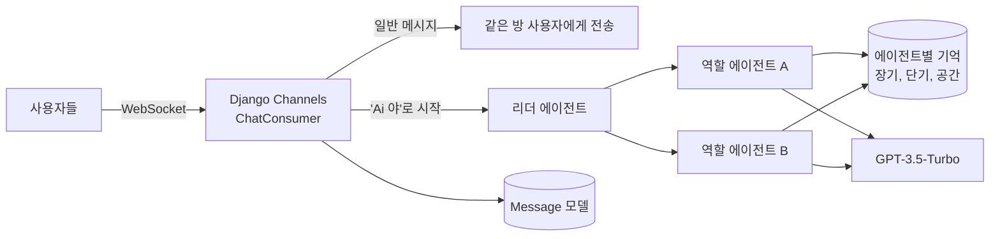
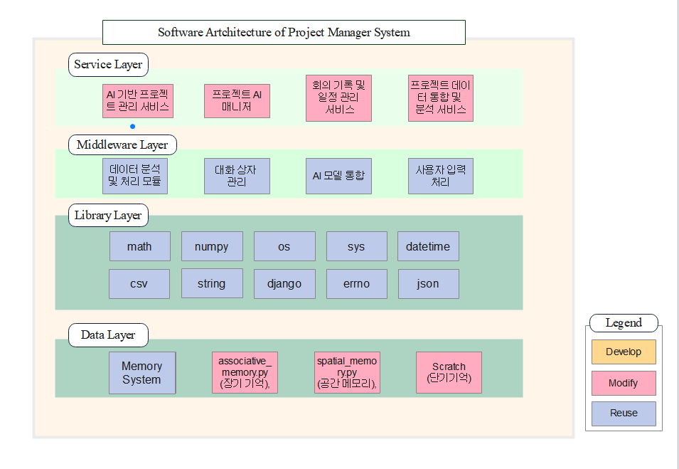
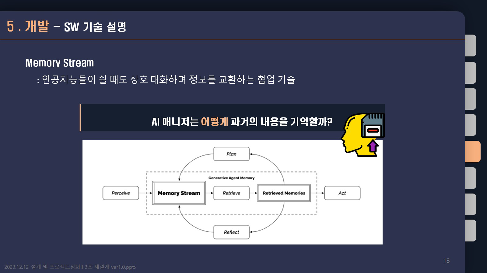
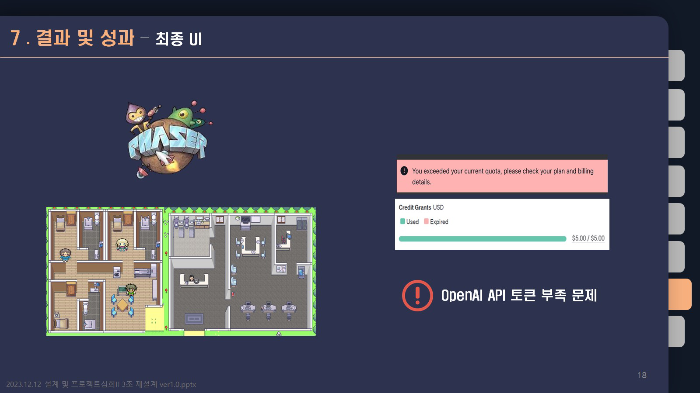
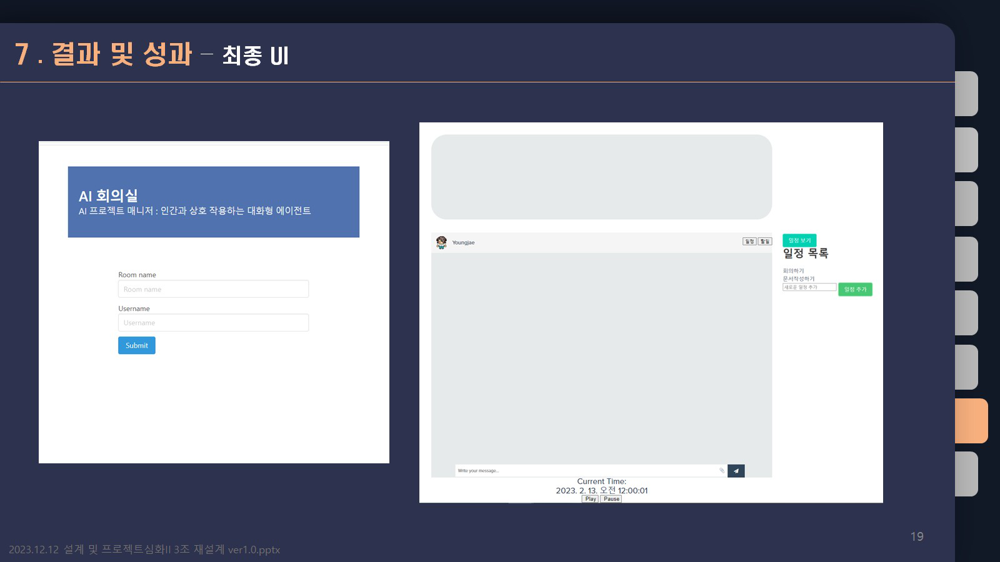

# AI 프로젝트 매니저, 인간과 상호작용하는 대화형 에이전트

Stanford의 Generative Agents(2023) 논문 구조를 바탕으로, 역할이 다른 AI 에이전트들이 토론하고 사용자가 리더 에이전트를 프로젝트 매니저처럼 불러 쓰는 시스템입니다. 건양대학교 의료IT공학과 설계및프로젝트심화 수업에서 4인 팀의 팀장으로 진행했습니다.

> 원본 코드 저장소는 남아 있지 않습니다. 이 저장소의 코드는 최종보고서 부록 4에 실린 코드를 옮긴 것이고, PDF에서 깨진 들여쓰기만 정리했습니다.

## 개요

| 항목 | 내용 |
| --- | --- |
| 기간 | 2023.06 ~ 2023.12 (6~8월 논문 분석과 준비, 9~12월 구현) 
|
| 팀 | 4인, 팀장 |
| 기술 | Python, Django, Django Channels(WebSocket), OpenAI GPT-3.5-Turbo, JSON |

## 내가 한 일

- 팀장으로 일정과 역할을 나누고 진행 관리
- 논문의 메모리 구조(장기 기억, 단기 기억, 공간 기억) 분석과 구현
- 에이전트 페르소나 설계(JSON으로 나이, 성향, 배경, 현재 상황, 생활 방식 정의)
- Django Channels로 여러 사용자가 함께 쓰는 실시간 채팅방 구현
- 에이전트끼리 순서대로 발언하도록 하는 상호작용 구현, 메모리 스트림과 채팅 병합

게임 형태의 시뮬레이션 화면(Phaser, Tiled)과 일정 관리 기능은 팀원이 맡았습니다.

## 구조



채팅방은 두 가지입니다. 하나는 AI끼리 토론하는 방이고, 다른 하나는 여러 사용자가 대화하다가 "Ai 야"로 시작하는 메시지를 보내면 리더 에이전트를 불러 실제 프로젝트 매니저처럼 쓰는 방입니다.




## 문제와 해결

1. 답변 쏠림. 처음에는 모든 에이전트가 같은 기억을 공유해서, 역할이 달라도 비슷한 답만 나왔습니다. 팀원은 페르소나가 부족하다고 봤고 저는 메모리 구조가 원인이라고 봤습니다. 각자 수정안을 만들어 같은 주제로 돌려 비교했고, 둘 다 효과가 있어 함께 적용했습니다. 부록 코드의 `persona_histories`처럼 에이전트마다 대화 기억을 따로 두는 방식이 이때 들어갔습니다.
2. 토큰 비용. 4개 에이전트로 실험하자 OpenAI API 토큰이 빠르게 소진됐습니다(발표 자료의 "OpenAI API 토큰 부족 문제"). 에이전트를 3개로 줄이고, 발언은 최대 6회, 에이전트가 생각하는 시간은 10분으로 제한했습니다. 부록 코드에서는 `max_conversation_length = 6`, `max_tokens=150`으로 남아 있습니다.



## 결과

- AI끼리 토론하는 채팅방과, 리더 에이전트를 불러 쓰는 다중 사용자 채팅방 구현
- 에이전트별 기억 분리로 역할별 관점이 드러나는 토론 흐름 확보
- 한계: 논문의 기억 검색 점수와 Reflection(회고)은 구현하지 못함



## 폴더

```
code/chat/consumers.py        WebSocket 채팅, 사람과 AI 메시지 구분, 에이전트 순차 호출
code/chat/views.py            페르소나 정의, 페르소나별 대화 기억, GPT 호출
code/chat/models.py, urls.py  메시지 저장 모델, 라우팅
code/chat/templates/chat/     채팅방, 방 입장 화면
docs/                         최종보고서 공개용 PDF (개인정보 가림)
images/                       구조도, 발표 자료, 화면
```

부록에 실린 코드는 채팅 연동 버전이라 페르소나가 두 개(Developer, ProjectManager)로 되어 있습니다. 메모리 스트림 쪽 코드는 보고서에 실리지 않았습니다. 실행에 필요한 settings, asgi, 메모리 모듈이 없어서 이 코드만으로는 실행되지 않습니다.
